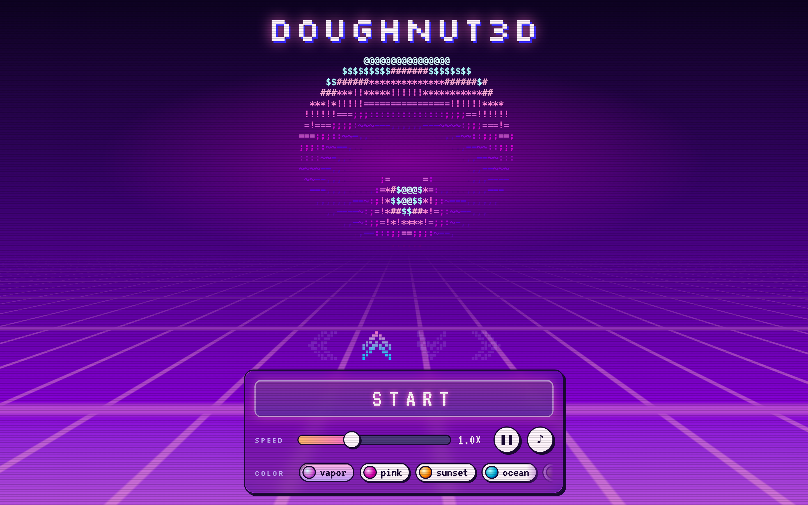
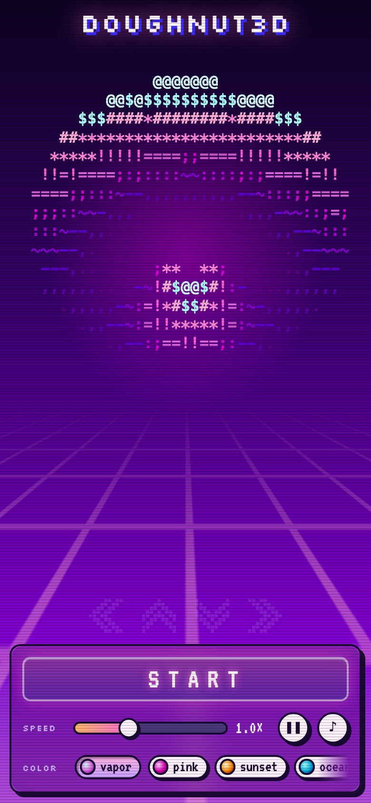
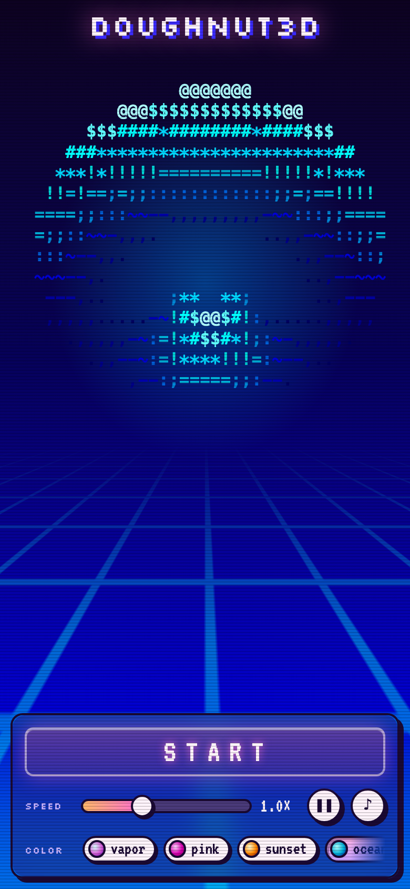
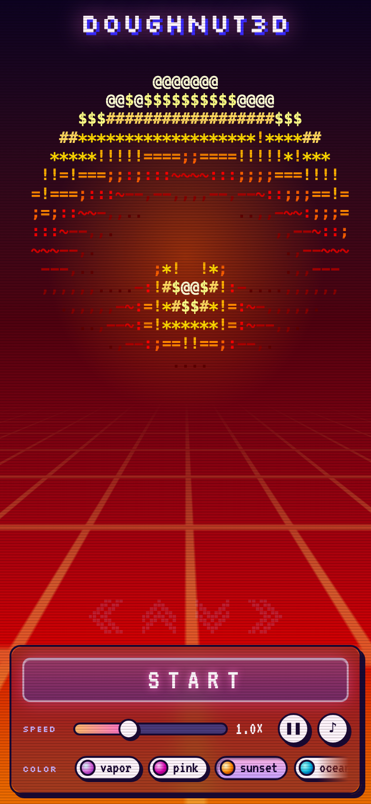
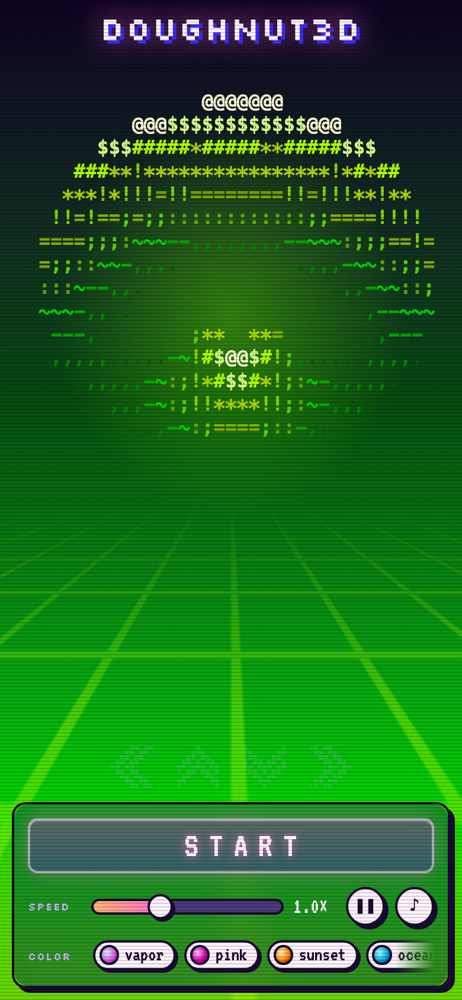
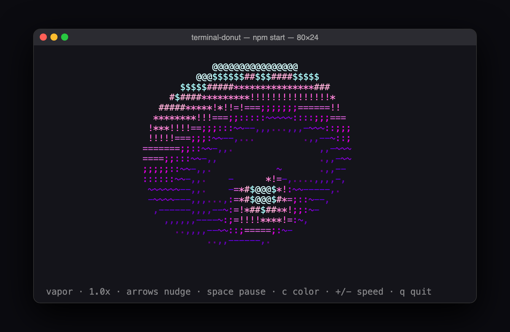
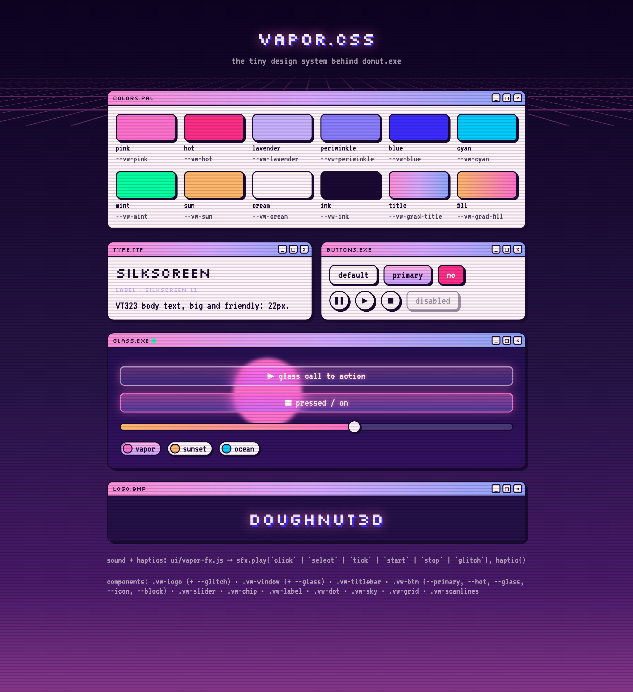

# DOUGHNUT3D 🍩

A spinning 3D ASCII donut that lives in your terminal **and** in your browser. You can steer it by tilting your phone or moving your mouse. It's wrapped in a vaporwave design system with synthesized sound bytes and haptics.

**▶ Play it:** https://blu-octopus.github.io/terminal-donut/



<table>
  <tr>
    <td></td>
    <td></td>
    <td></td>
    <td></td>
  </tr>
  <tr>
    <td align="center">vapor</td>
    <td align="center">ocean</td>
    <td align="center">sunset</td>
    <td align="center">matcha</td>
  </tr>
</table>



## Features

- **Real 3D math in plain text:** a torus that's rotated, perspective-projected, z-buffered and lit, drawn as `.,-~:;=!*#$@`.
- **Tilt to steer:** lay your phone flat for a top-down view, then tilt. The motion eases in, cruises at a capped speed and eases out, with no runaway spin.
- **Mouse to steer** on desktop: the donut's face follows your cursor.
- **Terminal edition:** the same engine runs in your terminal in 256 colors (`npm start`).
- **Six color themes** (vapor, pink, sunset, ocean, matcha, mono). The sky gradient and the grid floor change with them.
- **Vaporwave design system** ([vapor.css](ui/vapor.css)): retro OS windows, glass buttons, pill sliders and pixel type, all scaling with the screen.
- **Sound bytes** synthesized live with Web Audio, plus **haptic taps** on phones (Android and iOS 18+).
- **Easter egg:** tap the DOUGHNUT3D logo.

## Quick start

### In the browser (no install)

Open **https://blu-octopus.github.io/terminal-donut/** and press **START**:
- **Phone:** tap **Allow** for motion access, lay the phone flat, then tilt.
- **Desktop:** move your mouse. The ♪ button toggles sound.

Add `?theme=ocean` (or `sunset`, `matcha`, `pink`, `mono`) to the URL to start on a different color.

### In your terminal

Requires [Node.js](https://nodejs.org) 18+. There are no dependencies to install.

```bash
git clone https://github.com/blu-octopus/terminal-donut.git
cd terminal-donut
npm start
```

### Run the web app locally

```bash
npm run web
```

Then open http://localhost:8000. Phone tilt needs https, so test tilt on the GitHub Pages link; locally, the mouse works.

## Controls

| Control | Phone | Desktop | Terminal |
|---|---|---|---|
| Start / stop steering | **START** ↔ **AUTO** button | **START** ↔ **AUTO** button | |
| Steer | tilt the phone | move the mouse | arrow keys nudge |
| Speed | slider | slider | `+` / `-` |
| Pause spin | ❚❚ | ❚❚ | `space` |
| Color | color chips | color chips | `c` |
| Sound | (haptics instead) | ♪ | |
| Quit | | | `q` |

While steering, the speed slider sets the donut's maximum turning speed.

## How it works

```
                 src/donut-core.js  (shared engine: math, themes, motion)
                    │                                   │
     index.html (browser / phone)               src/main.js (terminal)
     canvas · tilt / mouse · UI                 256-color ANSI · keyboard
```

One engine file runs in both the browser and Node. Each host turns its input (phone tilt, mouse or keys) into the donut's orientation, a quaternion, and draws the result its own way: characters on a canvas, or colored text in a terminal.

**→ Full explanation, including the math, the motion design, the design system, bugs we hit and ideas for what to build next: [docs/HOW-IT-WORKS.md](docs/HOW-IT-WORKS.md)**

### Tech stack

| | |
|---|---|
| Language | Plain JavaScript (ES modules), no framework, no build step |
| Terminal | Node.js, ANSI escape codes, raw-mode keyboard input (zero dependencies) |
| Browser | Canvas 2D, DeviceOrientation API, Web Audio API, Vibration API |
| Styling | Hand-written CSS (custom properties, `@property`, `backdrop-filter`, 3D transforms) |
| Hosting | GitHub Pages |

### Project structure

```
index.html            the controller / web app (phone + desktop)
design-system.html    every vapor.css component on one page
src/
  donut-core.js       shared engine: torus render, themes, motion
  math.js             quaternions + tilt conversion
  main.js             terminal app
  renderer.js         terminal (ANSI) drawing
ui/
  vapor.css           vaporwave design system
  vapor-fx.js         synthesized sounds + haptics
lessons/              step-by-step build-up of the donut (npm run step1…5)
docs/                 HOW-IT-WORKS guide + screenshots
```

### Tweak the feel

All in [src/donut-core.js](src/donut-core.js):
- `TILT_ACCEL`: how quickly it speeds up and slows down
- `TILT_MAX_SPEED`: top turning speed
- `SENSOR_SMOOTHING`: how much sensor jitter is filtered out
- `SPIN_A` / `SPIN_B`: auto-spin speeds

If tilting feels backwards, set `TILT_DIRECTION = -1` in [src/math.js](src/math.js).

## The vapor.css design system



Tokens (`--vw-*`) and components for logo, window, title bar, buttons, slider, chips, labels, status dot, sky, grid floor and scanlines, plus [vapor-fx.js](ui/vapor-fx.js) for sounds and haptics. Everything is sized in `rem`, so a page can scale the whole system with one root font size. Browse it at [design-system.html](design-system.html), or tap the logo on the donut page.

## Troubleshooting

| You see | What it means | Fix |
|---|---|---|
| **NO ACCESS** on the button | Your browser refused motion access: you tapped "Don't Allow", or the prompt failed | Close the tab and reopen the link, then tap **Allow**. On iPhone you can also clear the site's data (Settings → Apps → Safari → Advanced → Website Data) |
| **NEEDS HTTPS** on the button | The page was opened over plain http, where phones block motion sensors | Use the GitHub Pages link (https) |
| Old styles after an update | Browser cache | Hard refresh (Cmd+Shift+R). GitHub Pages can take ~10 minutes to update |
| Donut moves the wrong way | Preference! | Set `TILT_DIRECTION = -1` in [src/math.js](src/math.js) |

## Learning path

Want to build it yourself from scratch? [lessons/](lessons/) builds the donut up in five runnable steps (`npm run step1` … `npm run step5`), and [LEARNING_PATH.md](LEARNING_PATH.md) is the curriculum.

## Credits & references

### Inspiration
- **Andy Sloane (a1k0n)**: the original spinning ASCII donut. [Donut math: how donut.c works](https://www.a1k0n.net/2011/07/20/donut-math.html) (2011) and the original [obfuscated donut.c](https://www.a1k0n.net/2006/09/15/obfuscated-c-donut.html) (2006). The torus, projection, z-buffer, lighting and the `.,-~:;=!*#$@` shading ramp all come from this work.
- **[@MarceloDesignX](https://x.com/MarceloDesignX/status/2117134324281565583)**: the post that sparked this project.
- **Vaporwave moodboard**: retro OS window kits, Windows 95-era UI and synthwave imagery collected from around the web. The original artists of those reference images are unknown; no assets from them are used here, only the visual direction.

### Libraries & tools
- [Node.js](https://nodejs.org) and [GitHub Pages](https://pages.github.com)
- An earlier version linked the phone to the terminal over WebSockets. That feature is retired from this repo (it's in git history at `0f9cd60`), and it used [ws](https://github.com/websockets/ws) (MIT), [qrcode-terminal](https://github.com/gtanner/qrcode-terminal) (Apache-2.0) and [Cloudflare quick tunnels](https://developers.cloudflare.com/cloudflare-one/connections/connect-networks/do-more-with-tunnels/trycloudflare/) via [cloudflared](https://github.com/cloudflare/cloudflared).

### Fonts
- [Silkscreen](https://fonts.google.com/specimen/Silkscreen) by Jason Kottke (SIL Open Font License)
- [VT323](https://fonts.google.com/specimen/VT323) by Peter Hull (SIL Open Font License)

### Techniques & specs
- Ken Shoemake, [*Animating rotation with quaternion curves*](https://doi.org/10.1145/325165.325242), SIGGRAPH 1985: quaternions and slerp
- [Lambert's cosine law](https://en.wikipedia.org/wiki/Lambert%27s_cosine_law): diffuse lighting
- W3C [DeviceOrientation Event specification](https://www.w3.org/TR/orientation-event/) and MDN's [DeviceOrientationEvent](https://developer.mozilla.org/en-US/docs/Web/API/DeviceOrientationEvent) docs
- MDN: [Web Audio API](https://developer.mozilla.org/en-US/docs/Web/API/Web_Audio_API), [Vibration API](https://developer.mozilla.org/en-US/docs/Web/API/Vibration_API), [CSS `@property`](https://developer.mozilla.org/en-US/docs/Web/CSS/@property), [`backdrop-filter`](https://developer.mozilla.org/en-US/docs/Web/CSS/backdrop-filter)
- [ANSI escape codes](https://en.wikipedia.org/wiki/ANSI_escape_code): the 256-color palette and cursor control
- The iOS haptic technique (toggling a native `<input type="checkbox" switch>`, iOS 18+) is a community-discovered workaround for Safari's missing Vibration API

### Built by
Designed and directed by **Daphne Cheng** ([@blu-octopus](https://github.com/blu-octopus)), built with [Claude Code](https://claude.com/claude-code).
